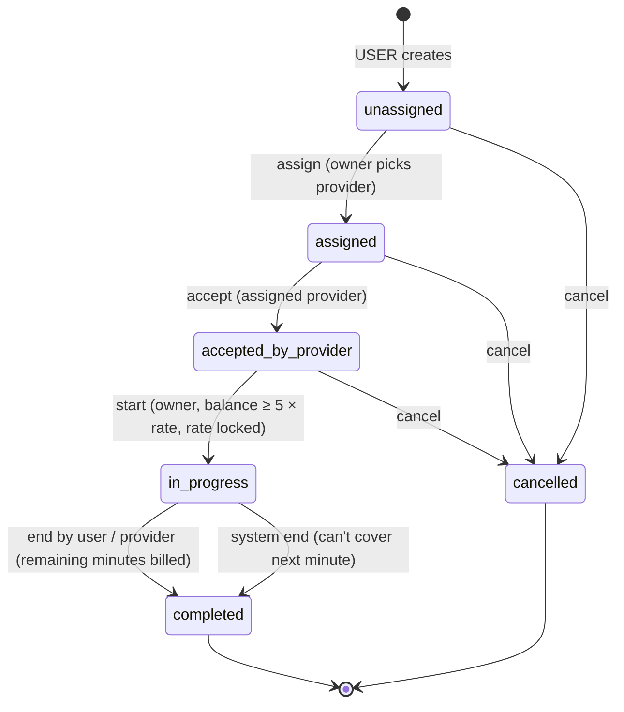
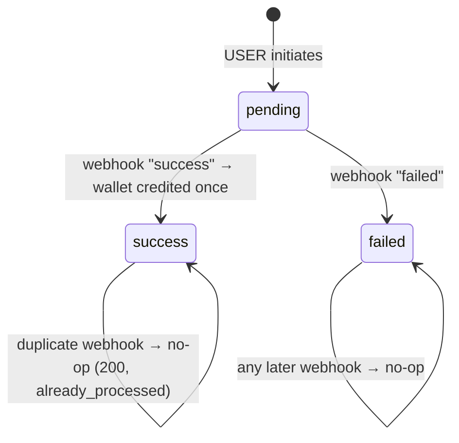
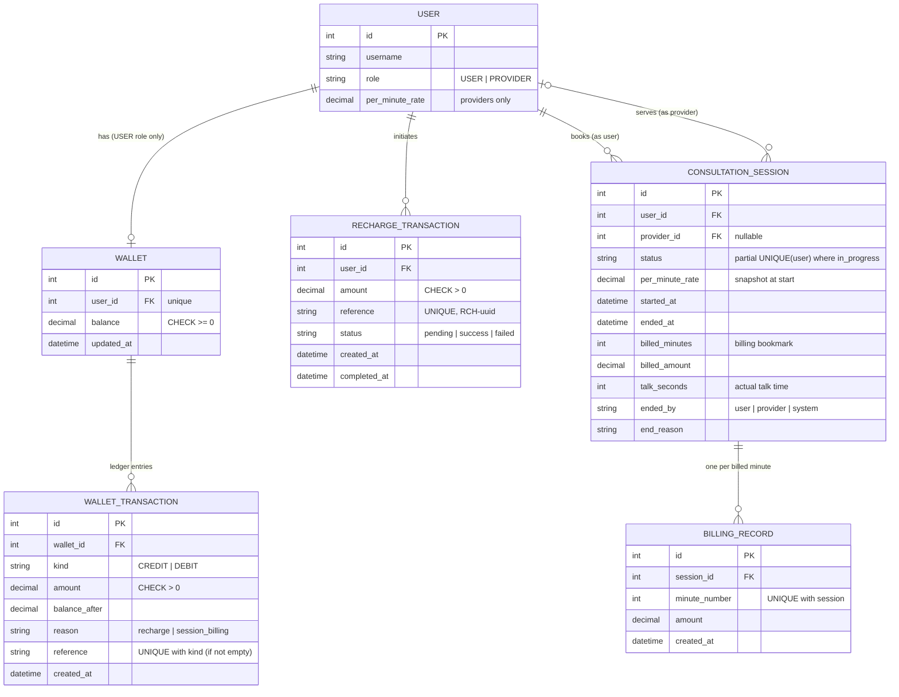
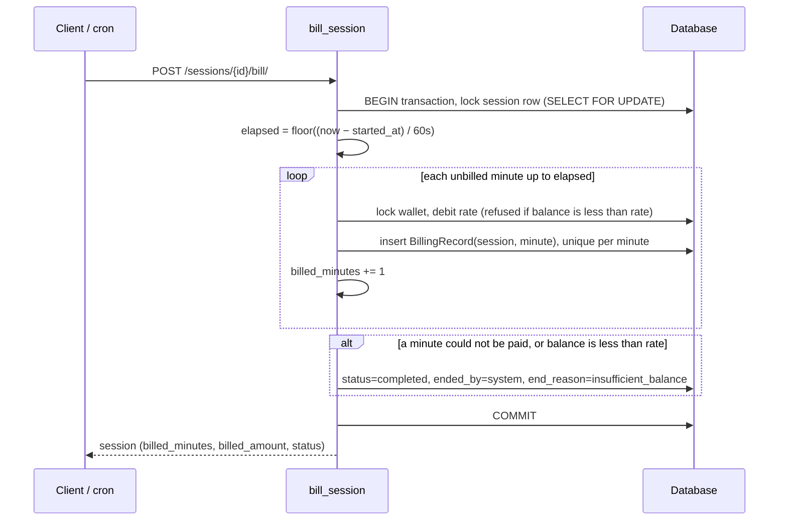

# Diagrams

GitHub renders the Mermaid blocks below as diagrams.

## Session state machine

Any other action returns **HTTP 400 `invalid_transition`**. The whole table lives in
`consultations/state_machine.py`:

| Action | Allowed from | Moves to |
|---|---|---|
| `assign` | `unassigned` | `assigned` |
| `accept` | `assigned` | `accepted_by_provider` |
| `start` | `accepted_by_provider` | `in_progress` |
| `end` (user, provider or system) | `in_progress` | `completed` |
| `cancel` | `unassigned`, `assigned`, `accepted_by_provider` | `cancelled` |

A completed session records `ended_by` (`user` / `provider` / `system`) and `end_reason`
(`user_ended` / `provider_ended` / `insufficient_balance`).

## Recharge lifecycle

## Entity-relationship diagram

## Billing sequence (one `bill` call)

